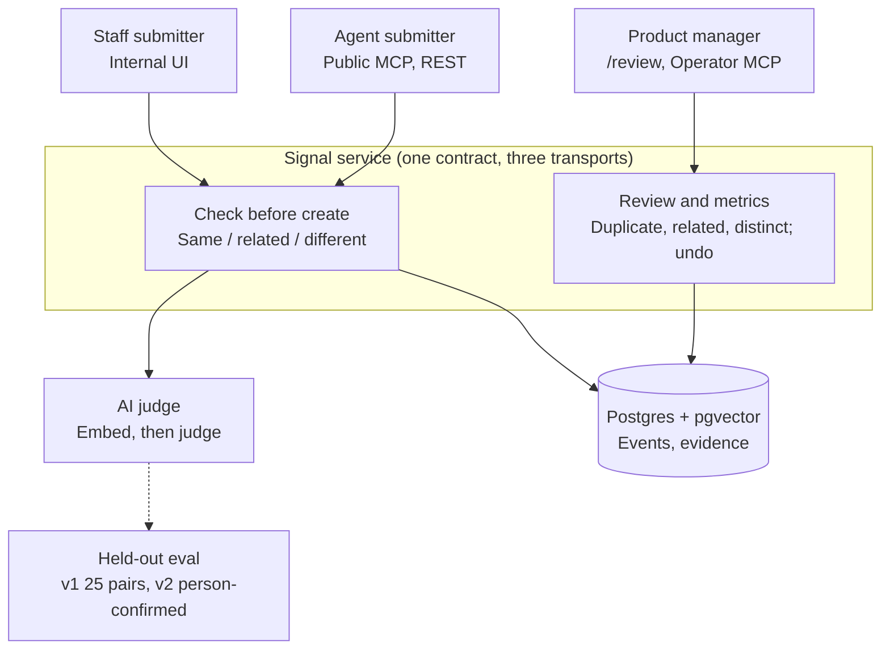

# meta-cto

**Signal**: a verdict before every create for feature requests, built API and MCP first ([PRODUCT.md](./PRODUCT.md)). Built on the `flow-next` Next.js template (Assistant, Operator, GenUI, MCP).

## Architecture

Signal ([PRODUCT.md](./PRODUCT.md)): one service, three ways in. Details in [ARCHITECTURE.md](./ARCHITECTURE.md).



## Quick start

```bash
pnpm setup
pnpm dev
```

Open `https://meta-cto.localhost` (Portless proxy on 443, never a port in the URL; run `pnpm setup:portless` once). Configure `.env.local` from `.env.example`.

## Scripts

| Script                                        | Purpose                                                                                                                                                       |
| --------------------------------------------- | ------------------------------------------------------------------------------------------------------------------------------------------------------------- |
| `pnpm setup`                                  | Prerequisites + non-destructive `.env.local`                                                                                                                  |
| `pnpm dev`                                    | Development via Portless (`https://meta-cto.localhost`, no port)                                                                                              |
| `pnpm dev:port`                               | Plain `next dev` on loopback `localhost:<port>` for parallel agents (one per worktree, copy `.env.local` in); pass `PORT` or let Next pick the next free port |
| `pnpm qa`                                     | Lint, types, tests                                                                                                                                            |
| `pnpm build`                                  | Production build (includes MCP App bundle)                                                                                                                    |
| `pnpm eval`                                   | Offline GenUI eval + Eve tool smoke                                                                                                                           |
| `pnpm eval:verdict`                           | Signal verdict eval on the frozen Held-Out Set (v1; `--set held-out-v2` once frozen). Costs tokens; manual only                                               |
| `pnpm signal:scan`                            | Backlog scan for suspected duplicates (Operator action, never in builds)                                                                                      |
| `pnpm signal:pilot:check` / `freeze` / `load` | Pilot files readiness, freeze (fingerprint lock), and load into the Pilot Workspace. Run from the repo root; never in builds                                  |

## Surfaces

- **Signal UI** — `/`, `/requests`, `/requests/new`, `/requests/[id]`, `/review` (actions need Operator sign-in), `/proof` (Operator only)
- **Signal REST** — `/api/checks`, `/api/feature-requests`, `/api/metrics`, `/api/review/*`, `/api/proof`; listed in `/openapi.json`. The Pilot Workspace needs the `x-signal-pilot-key` header (`SIGNAL_PILOT_KEY`)
- **MCP** — `/api/mcp` (Signal tools; the Pilot Key selects the Pilot Workspace), `/api/mcp/operator` (review tools; requires `OPERATOR_SECRET`)
- **Template** — `/genui`, `/api/chat`, `/mcp`, `/operator`

Cross-template contract: [docs/INTEROP.md](./docs/INTEROP.md).

Agent skills for this stack: [docs/agent-skills.md](./docs/agent-skills.md).

## Deploy

Vercel-first; `vercel.json` runs `pnpm build`. Set gateway and operator secrets in the project environment.
