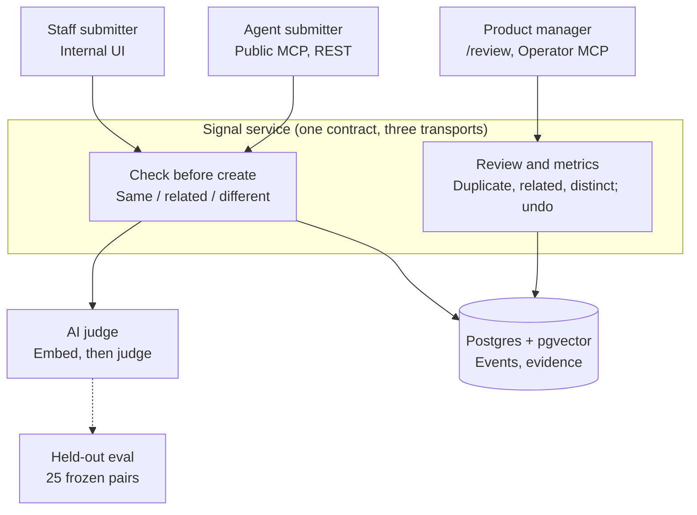

# meta-cto

Single-app agentic Next.js template: public Assistant, protected Operator, Eve, OpenUI Lang GenUI, MCP Streamable HTTP, and MCP Apps.

## Architecture

Signal ([PRODUCT.md](./PRODUCT.md)): one service, three ways in. Details in [ARCHITECTURE.md](./ARCHITECTURE.md).



## Quick start

```bash
pnpm setup
pnpm dev
```

Open `https://meta-cto.localhost` (Portless proxy on 443, never a port in the URL; run `pnpm setup:portless` once). Configure `.env.local` from `.env.example`.

## Scripts

| Script          | Purpose                                                                                                                                                       |
| --------------- | ------------------------------------------------------------------------------------------------------------------------------------------------------------- |
| `pnpm setup`    | Prerequisites + non-destructive `.env.local`                                                                                                                  |
| `pnpm dev`      | Development via Portless (`https://meta-cto.localhost`, no port)                                                                                              |
| `pnpm dev:port` | Plain `next dev` on loopback `localhost:<port>` for parallel agents (one per worktree, copy `.env.local` in); pass `PORT` or let Next pick the next free port |
| `pnpm qa`       | Lint, types, tests                                                                                                                                            |
| `pnpm build`    | Production build (includes MCP App bundle)                                                                                                                    |
| `pnpm eval`     | Offline GenUI eval + Eve tool smoke                                                                                                                           |

## Surfaces

- **Assistant** — `/`, `/genui`, `/api/chat`, `/api/mcp`, `/mcp`
- **Operator** — `/operator`, `/api/operator/chat`, `/api/mcp/operator` (requires `OPERATOR_SECRET`)

Cross-template contract: [docs/INTEROP.md](./docs/INTEROP.md).

Agent skills for this stack: [docs/agent-skills.md](./docs/agent-skills.md).

## Deploy

Vercel-first; `vercel.json` runs `pnpm build`. Set gateway and operator secrets in the project environment.
